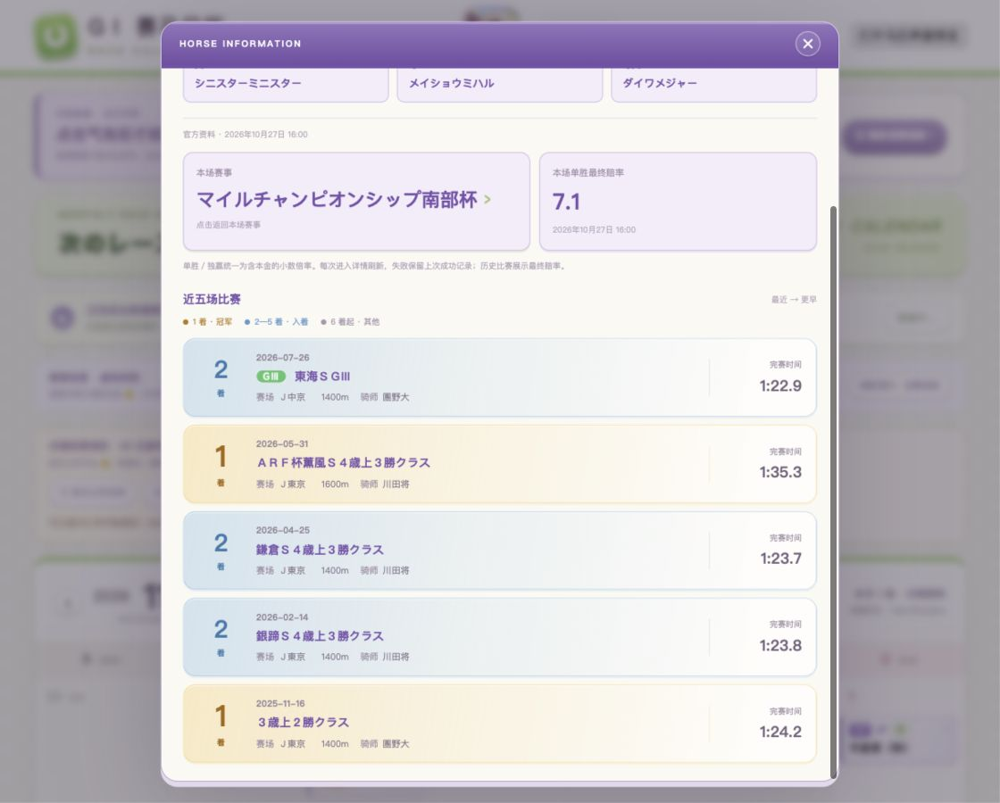

# G1 Race Calendar

**TEST VERSION — v0.2.7 / Dev v2.7. This project is under active development and is not a stable release.**

[English](README.md) · [简体中文](README.zh-CN.md)

A local-first horse racing calendar for macOS, with a desktop monthly calendar, race and horse details, local caching, and a virtual-ticket mini-game. The bright interface is inspired by *Umamusume: Pretty Derby*.

## Current features

- Monthly calendar with year/month navigation, region filters, region colors, race grades, and turf/dirt labels.
- Japanese flat GⅠ and JpnⅠ races, plus overseas races selected from the corresponding year's Longines/IFHA top 100 list where available.
- Race declarations and results from connected official sources, with Win odds, prize information, and source links when obtainable.
- Horse basics, pedigree, and the five starts **before the selected race**, subject to source coverage.
- Local SQLite storage with resumable background collection and year-by-year detail management. Clearing a year preserves calendar dates and tickets.
- English, Japanese, and Chinese UI. Race and horse names follow their source naming rules.
- Virtual funds, a daily virtual bank allowance, tickets, refunds, and result notifications. The mini-game uses local virtual currency.
- Finish-based history cards and a 2D character indicator for loading, completion, and cached data.



*Development preview using a saved official race sample.*

## What's new in v0.2.7

- The app checks the current year and the next two years at startup. Background collection can resume from saved progress, and race details can be cleared or downloaded again by year.
- Added a fallback for the official JRA annual calendar and a snapshot of the published 2027 NAR schedule. The November 7 native check loaded 44 races for 2027, including 24 JRA, 13 NAR, and 7 overseas races within the current IFHA selection.
- Rescheduled races no longer display declarations or results from the old date. An empty source response preserves valid cached details for the same date.

## Test-version status

The calendar, data adapters, cache management, and mini-game are still being tested. Some design/demo screens contain explicitly marked fictional fixtures. They should not be confused with fetched official records.

Data coverage is incomplete. A race appearing on the calendar does **not** guarantee that its declarations, result, odds, or complete horse history can be retrieved. Overseas details currently depend substantially on HKJC's simulcast archives, which do not cover every race or year. Missing fields remain missing; the app distinguishes loading, connection failures, and records it could not match.

The latest recorded 2025 sample checks retrieved details for 93 of 122 selected races after a full run and focused rechecks. This is a coverage snapshot, not a guarantee of current availability. See the [history/future query report](research/2026-11-05-history-future/README.md) and [current UI validation](research/2026-11-06-horse-ui/README.md).

## Build and run on macOS

Requirements:

- Apple Silicon Mac running macOS 13 or later for the currently tested target.
- Xcode Command Line Tools, providing `swiftc`, the macOS SDK, and signing tools.
- Python 3 for the optional browser preview.
- Node.js for the optional regression checks.

```sh
git clone https://github.com/Oct3H/g1-race-calendar.git
cd g1-race-calendar
bash desktop/build.sh
open "dist/GⅠ 赛马日历 Dev v2.7.app"
```

The app bundles its UI and starts its own loopback server; the separate preview server is not needed to run the native app. The build uses macOS system frameworks: AppKit, WebKit, Foundation, and SQLite. Build artifacts are excluded from Git.

The current development build stores its settings, cache, and virtual wallet in:

```text
~/Library/Application Support/G1 Race Calendar Dev/calendar.sqlite
```

User databases and wallet state are not part of this repository. Fully quit an older development build with **⌘Q** before opening a new one.

## Browser design preview

```sh
python3 serve_preview.py
```

Open [the calendar preview](http://127.0.0.1:8765/desktop-calendar-preview.html?lang=en) or [the horse UI review](http://127.0.0.1:8765/index.html?horseReview=preview&preview=calendar&settingsMenu=preview&lang=en&v=85).

The browser preview is for UI review. Native network access and SQLite persistence require the macOS app. The horse review's state buttons demonstrate animations; they do not fetch new race data.

## Regression checks

Run the existing offline checks from the project root:

```sh
for test_file in research/check_*.mjs
do
  node --experimental-vm-modules "$test_file" || exit 1
done
```

The last recorded suite has 24 passing checks. Native development checks are implemented in [`desktop/Smoke.swift`](desktop/Smoke.swift) and use isolated profiles through `--data-dir`; they must not be pointed at a real wallet for testing.

## Project structure

| Path | Purpose |
| --- | --- |
| `design/` | Shared HTML/CSS/JavaScript UI, adapters, assets, and browser previews |
| `desktop/` | Swift macOS host, local server, SQLite bridge, build script, and native checks |
| `research/` | Source validation, public response fixtures, regression checks, and reports |
| `ROADMAP.md` | Development roadmap and remaining integration work, primarily in Chinese |

## Sources and credits

Connected source adapters include JAIRS/JRA, NAR, IFHA, and the Hong Kong Jockey Club. Coverage and field availability vary by source. Saved official responses are used as regression fixtures; this repository does not include personal app data.

This is an unofficial fan project. Character and visual references are credited in [`design/assets/SOURCES.md`](design/assets/SOURCES.md). The loading character was generated for this project; its [prompt and provenance](design/assets/agnes-tachyon-status-prompt-85.md) are retained. The bundled LinkeDOM test helper retains its [upstream license](research/language-audit-76/vendor/LICENSE.linkedom).

No project-wide software license has been selected yet.
